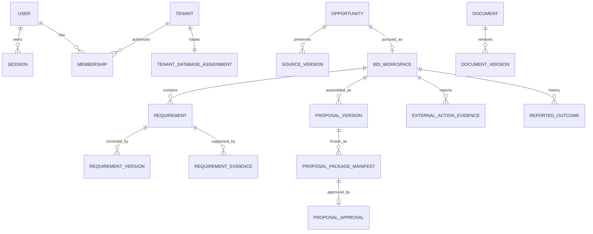

# Bidora backend contracts

Status: **API-CONTRACT-01 — IMPLEMENTED_NOT_VERIFIED contract candidate**  
Canonical REST artifact: [`../api/openapi/bidora.openapi.json`](../api/openapi/bidora.openapi.json)  
DTO schema catalogue: [`../api/openapi/bidora.schemas.json`](../api/openapi/bidora.schemas.json)  
Endpoint inventory: [`../api/openapi/endpoint-inventory.md`](../api/openapi/endpoint-inventory.md)  
Broker contract: [`../api/asyncapi/ai-entitlement.json`](../api/asyncapi/ai-entitlement.json)  
Postman: [`../../postman.json`](../../postman.json)

This document describes contracts already represented by Bidora source. It does not authorize a new handler, activate a route, grant a capability, select a provider, or resolve blocked policy.

## 1. Service overview and assumptions

Bidora is a Go/Fiber modular monolith backed by PostgreSQL/pgx/sqlc. It provides browser-session identity, shared membership operations, Platform Administration governance, and tenant-private Tenderpreneur tender preparation. Control-plane identity, tenant routing, membership, platform governance and commercial authority remain separate from each tenant's private data database. Cross-plane effects use durable outbox/checkpoint/reconciliation flows, never synchronous cross-database transactions.

### Actors and consumers

| Actor/consumer | Contract boundary |
|---|---|
| Unauthenticated browser user | Registration, email verification, password/Google login and recovery only; generic anti-enumeration failures. |
| Authenticated Bidora user | Own sessions, MFA, recovery readiness and portal routing; account type does not grant authority. |
| Tenderpreneur member | Tenant operations only after current ACTIVE membership, ACTIVE tenant, exact context/assignment generations and explicit capability evaluation with DENY precedence. |
| Platform Administrator | Platform operations only with an effective active platform role, exact governance context, required capability and recent TOTP-backed AAL2 where governed; no automatic tenant-private access. |
| Frontend and approved API clients | Consume canonical OpenAPI; retain cookies in a secure browser context and keep CSRF values memory-only. |
| Background workers | Claim durable jobs/outbox records, reauthorize where required, use leases and idempotent completion, and write safe terminal/retry evidence. |
| Deployment operators | Supply TLS roots, credentials references and provider settings; migrations and runtime grants remain separate executables. |
| NATS consumer | Idempotently applies AI entitlement reservation requests to control-commercial state. |

### External dependencies

| Dependency | Responsibility and boundary |
|---|---|
| PostgreSQL | Control and one private database per tenant; verified TLS/SCRAM; runtime never migrates or provisions. |
| Redis | Ephemeral attempt, MFA and OIDC state only; fail closed; never business truth. |
| MinIO-compatible S3 | Private immutable object versions and bounded upload instructions; object keys are never browser authority. |
| ClamAV | Fail-closed quarantine scan; analysis cannot process before exact version is CLEAN. |
| OpenAI | Advisory cited extraction/drafting for authorized CLEAN inputs only; outputs remain `PROPOSED_UNVERIFIED`. |
| SMTP | Authenticated STARTTLS verification delivery; recipient, token and credentials are never logged. |
| Google OIDC | Fixed endpoints, state/nonce/PKCE and verified claims; matching email never silently links. |
| NATS JetStream | At-least-once AI entitlement request transport with explicit topology and ACLs. |
| Poppler `pdftotext` | Explicit absolute executable path only; no `PATH` discovery. |

### Explicit assumptions and unresolved requirements

1. Implemented handlers, accepted decisions and executable schemas outrank stale prose or a draft filename.
2. The canonical bundle is a **contract candidate**. Route presence in the bundle does not assert deployment activation.
3. Full tenant provisioning/suspension/reactivation remains blocked by BID-TEN-001, BID-TEN-003 and BID-ADR-015; no lifecycle API is inferred.
4. Procurement/exchange APIs are outside this release and are not represented.
5. Commercial formulas, tax treatment, provider effects, retention authority and countries provenance remain unchanged and are not inferred.
6. The source fragments still have 85 successful operations whose response body is not structurally specified, 54 operations without a source description, and 3 operations without an explicit error status. Those operations are not yet suitable for independent client generation despite being included for drift visibility.

## 2. Domain model

### Control plane

| Aggregate/entity | Relationships and invariants |
|---|---|
| User / AuthenticationIdentity / ExternalIdentity | A user owns password and/or Google credentials under takeover-safe linking rules. Credentials never confer tenant or platform authority. |
| Session / MFAFactor / MFARecoveryCode / MFATransaction | Sessions belong to one user and auth epoch; assurance is explicit and rotatable. Factors and recovery material are protected and never exposed after issuance. |
| Tenant / DatabaseCluster / TenantDatabaseAssignment / SchemaVersion | A tenant has one active server-owned database assignment generation. Client selectors never choose a database. |
| Membership / RoleGrant / Invitation | Membership joins a user to a tenant; grants are explicit ALLOW/DENY capabilities. Active DENY wins. Invitations are single-use and versioned by fixed role bundle. |
| PlatformGovernanceProfile / RoleAssignment / AdministratorInvitation / ChangeProposal | Platform authority is independent of tenant authority and enforces maker/checker and final-owner rules. |
| CommercialSubscription / Invoice / Payment / Settlement / Adjustment / Reversal | Control-plane commercial state gates tenant writes. Provider observations and human decisions remain distinguishable. |
| AIUsageReservation / EntitlementCheckpoint | A tenant operation requests an idempotent control reservation and receives a routed acknowledgement before provider work. |
| AuditEvent / OutboxEvent / IdempotencyRecord | Every governed control transaction commits state, minimal audit, event and replay evidence atomically where applicable. |

### Tenant-private plane

| Aggregate/entity | Relationships and invariants |
|---|---|
| OrganizationProfile / LetterheadVersion | Singleton tenant profile has immutable letterhead versions and an explicit active version; it grants no membership authority. |
| Opportunity / SourceVersion | Opportunity owns immutable captured source versions; human verification appends a VERIFIED version and never rewrites source facts. |
| BidWorkspace / BidDecision | A verified opportunity may have one active MVP workspace; BID/NO_BID is human-only append-only history. |
| Document / DocumentVersion / UploadSession | A document owns immutable byte versions. Exact checksum/size/type and CLEAN scan state gate downstream use. |
| Requirement / RequirementVersion / RequirementEvidence | A bid owns requirements and immutable correction history; exact CLEAN evidence links can support human satisfaction. |
| ResponseSection / ResponseVersion / ResponseEvidence | A requirement has bounded plain-text technical revisions with exact evidence links; pricing is excluded from this slice. |
| Proposal / ProposalVersion / ProposalResponseVersion | A bid owns editable proposal revisions assembled from selected immutable response versions. |
| AIRequirementSuggestion / AIResponseDraftSuggestion / AIProposalDraftSuggestion | AI output is immutable, cited and unverified; only an authorized human can accept/apply it into a new authoritative revision. |
| ReviewThread / Comment / Assignment / InternalReviewDecision | Collaboration is append-oriented; internal review is not proposal approval. |
| ProposalPackageManifest / ProposalApproval | A manifest freezes an exact package candidate. Approval requires separate human authority and recent TOTP AAL2; it is not signing or submission. |
| ExternalActionEvidence / SubmissionConfirmation | Human-reported evidence refers to an exact package/proof. Bidora does not claim external transmission or acceptance. |
| ReportedOutcome / BidArchive | Outcomes remain `REPORTED_UNVERIFIED`; archive is immutable read-only closure, not deletion or legal disposition. |
| Audit / Outbox / Inbox / Idempotency / Job | Plane-local infrastructure supports atomic evidence, at-least-once processing and safe replay without cross-database joins. |



Cross-plane UUIDs are logical references, not foreign keys. Tenant databases never join control tables, and tenant projections never authorize.

## 3. API endpoint inventory

The generated [endpoint inventory](../api/openapi/endpoint-inventory.md) is the normative table for all **166 operations over 146 paths**. It records method, path, operation ID, purpose, effective authentication, headers, query controls, success/error statuses, idempotency and source fragment.

| Area | Operations | Primary responsibility |
|---|---:|---|
| Authentication | 26 | Identity entry, sessions, password recovery, MFA and account routing. |
| Shared Portal | 11 | Invitations, membership directory/offboarding and continuity-safe membership operations. |
| Platform Administration | 34 | Governance, tenants, integration settings and commercial administration. |
| Tenderpreneur | 92 | Dashboard, commercial state, opportunity-to-archive bid workflow and grounded AI assistance. |
| Health / operations | 3 | Health-only liveness/readiness and operational surface. |

## 4. Detailed request/response contracts

The canonical [`bidora.openapi.json`](../api/openapi/bidora.openapi.json) is the detailed operation-level contract. Every operation has:

- method, resource path, stable `operationId`, summary, source contract and source status;
- effective session/public security declaration;
- declared path/query/header parameters and request-body JSON Schema where present;
- response status map and referenced DTO schemas where the source contract defines one;
- namespaced components, preventing same-named DTOs in different bounded contexts from colliding;
- normalized required path parameters and the approved browser Origin/CSRF and Tenderpreneur tenant/context selectors.

### Universal wire conventions

| Concern | Contract |
|---|---|
| Base/version | HTTPS `/v1`; health is `/health/*`. Breaking semantics require a new version or approved compatibility plan. |
| JSON | UTF-8 `application/json`, `snake_case`, strict command objects, duplicate/unknown-field rejection and operation-specific byte ceilings. |
| IDs/time/money | UUID strings; RFC 3339 UTC instants plus source timezone/text where required; decimal money represented as strings unless an explicitly approved minor-unit contract says otherwise. |
| Tenant context | `X-Bidora-Tenant-ID` + positive `X-Bidora-Context-Generation`; selectors only. Server registry supplies the exact database assignment. |
| Platform context | Positive `X-Bidora-Platform-Context-Generation` where required; platform role labels alone do not authorize. |
| Browser writes | Exact approved HTTPS `Origin`, session cookie, equal `X-CSRF-Token`/CSRF cookie and session hash. |
| Concurrency | `expected_version` or `If-Match` as declared. Stale state returns a stable conflict and never silently overwrites. |
| Idempotency | Required `Idempotency-Key` where declared. Scope includes actor/operation and implicit tenant database; matching replay returns the safe original result, conflicting reuse returns 409. |
| Pagination | Opaque bounded cursor plus bounded `limit`; deterministic stable sort. Clients must not decode or construct cursors. |
| Caching | Private/authenticated responses are `private, no-store`; health responses are `no-store`. |

DTOs are published as JSON Schema 2020-12 in [`bidora.schemas.json`](../api/openapi/bidora.schemas.json). Required fields use `required`; nullable values use JSON Schema unions or explicit `null`; omitted optional fields and explicit null are not interchangeable unless stated by that operation. Source DTO names are namespaced by contract file to prevent accidental cross-module coupling.

## 5. Internal service interfaces

Bidora remains a modular monolith. These are port shapes, not permission for controllers to call sqlc repositories or for one module to use another module's tables directly.

```go
// HTTP adapter -> owning application service.
type CommandService[In, Out any] interface {
    Execute(ctx context.Context, input In) (Out, error)
}

type QueryService[In, Out any] interface {
    Get(ctx context.Context, input In) (Out, error)
}

// Application service -> same-plane transaction boundary.
type TransactionRunner interface {
    WithinTransaction(ctx context.Context, fn func(context.Context, postgres.DBTX) error) error
}

// Application service -> owner repository port. Concrete sqlc types do not cross this boundary.
type AggregateStore[Subject, Command, Result any] interface {
    Commit(ctx context.Context, subject Subject, command Command) (Result, error)
}

// Cross-plane routing. Caller supplies validated authority facts; resolver supplies the server-owned endpoint.
type AssignmentResolver interface {
    ResolveCurrent(ctx context.Context, tenantID ID, assignmentGeneration int64) (Assignment, error)
}

// Durable external dependency contract.
type Outbox interface {
    Claim(ctx context.Context, leaseID ID, now time.Time) (Record, bool, error)
    Published(ctx context.Context, record Record, now time.Time) error
    Retry(ctx context.Context, record Record, now time.Time) error
}
```

Expected failures are typed into four categories: invalid caller input, unauthenticated/forbidden authority, domain conflict/not-found, and dependency unavailable/cancelled. Adapters map only known categories to stable safe HTTP/event dispositions; wrapped database/provider diagnostics remain internal and redacted. Context cancellation and bounded deadlines are mandatory. SQL transactions never remain open during email, scan, object storage, renderer, model, KMS or broker calls.

## 6. Asynchronous event contracts

The implementation contains one active broker boundary: [`ai-entitlement.json`](../api/asyncapi/ai-entitlement.json).

| Contract | Value |
|---|---|
| Subject | `bidora.v1.tenant.ai_entitlement.reserve_requested` |
| Event type | `tenant.ai_entitlement.reserve_requested.v1` |
| Stream | `BIDORA_TENANT_AI_ENTITLEMENT` |
| Durable consumer | `control-commercial-ai-reservation-v1` |
| Producer | Tenant outbox bridge after tenant transaction commit. |
| Consumer | Control Commercial AI reservation service. |
| Delivery | At-least-once, explicit ack, maximum 9 deliveries, event UUID message dedupe. |
| Retry | 30s, 2m, 10m, 30m, 2h, 6h, 12h, 24h. |
| Poison/conflict | Terminate delivery; do not retry deterministic invalid/conflicting envelopes. |
| Temporary failure | Delayed negative acknowledgement. |
| Ordering | No global ordering; validate aggregate ID/version and idempotently consume event ID. |
| Acknowledgement return | Control outbox plus server-routed tenant dispatcher; not a second NATS contract. |

Other `*.v1` values in plane-local outboxes are durable internal event facts, not automatically public broker topics. Publishing them requires an approved AsyncAPI channel, privacy classification, ACL and consumer contract.

## 7. Standardized errors

```json
{
  "error": {
    "code": "WORKFLOW_CONFLICT",
    "message": "The workflow changed. Refresh and try again.",
    "field_errors": [
      {"path": "expected_version", "code": "stale", "message": "The version is no longer current."}
    ],
    "trace_id": "00000000-0000-0000-0000-000000000000",
    "retryable": false
  }
}
```

| HTTP | Meaning |
|---:|---|
| 400 | Strict syntax/header/query/validation failure that is safe to disclose. |
| 401 | Missing, invalid, expired, revoked or stale authenticated session. |
| 403 | Authenticated but current capability/assurance/tenant/commercial policy denies the operation. |
| 404 | Missing or deliberately concealed resource. |
| 409 | Version, state, idempotency, replay or governed workflow conflict. |
| 413 / 415 / 422 | Request too large / unsupported media / semantically invalid input where operation contract distinguishes it. |
| 429 | Attempt/rate limit; include bounded `Retry-After` where specified. |
| 500 | Safe unexpected failure; never SQL/provider/private diagnostics. |
| 503 | Required dependency or fail-closed authorization/routing dependency unavailable. |

Messages are stable and non-sensitive. Error codes are the machine contract. `trace_id` matches the server request ID. Validation paths identify contract fields only and never echo secret or private source values.

## 8. OpenAPI specification

The OpenAPI 3.1 bundle is generated from 55 source fragments. Component schemas, responses, headers and parameters are namespaced; security schemes are canonical. Generation also emits the JSON Schema catalogue, inventory and Postman collection.

```sh
cd backend && python3 api/openapi/generate.py
cd backend && python3 api/openapi/generate.py --check
```

`--check` performs deterministic byte comparison and validates every local `$ref`. The generated bundle must not be hand-edited; correct the owning source fragment or the explicitly documented normalization rule.

### Contract-testing strategy

| Layer | Required evidence |
|---|---|
| Static generation | Deterministic regeneration; OpenAPI/JSON Schema/AsyncAPI parsing; all local references resolve; unique method/path and operation IDs. |
| Route drift | Enumerate Fiber routes from the composed inert runtime and compare method/path/security-middleware expectations with OpenAPI, accounting explicitly for deployment-conditional routes. |
| Request conformance | For every operation, accept valid canonical examples and reject missing required fields, unknown/duplicate fields, invalid nullability, bounds, media types, headers and selectors. |
| Response conformance | Serialize real handler DTOs and validate every success/error response, status and required header against the canonical schema. No undocumented field is emitted. |
| Policy negatives | Prove unauthenticated, CSRF, stale context/assignment, DENY precedence, missing capability, stale version, replay conflict and MFA-assurance behavior. |
| Persistence/integration | Use real PostgreSQL/Redis/object/broker fixtures as applicable; prove transaction rollback, cross-tenant non-observation, duplicate delivery and ambiguous external effects. |
| Consumer compatibility | Generate a client from the accepted bundle, compile it, run representative frontend/provider stubs and reject breaking diffs unless an approved version plan exists. |
| Sensitive-data scan | Assert no contract/example/Postman/error contains credentials, raw tokens, provider secrets, object keys, database locators, SQL diagnostics or private tender text. |

Tests belong under `backend/tests/`; generated artifacts are never edited to make tests pass. Current generation checks are artifact validation only, not API acceptance.

## 9. Implementation examples

```http
POST /v1/tenderpreneur/opportunities/manual HTTP/1.1
Host: api.example.test
Origin: https://app.example.test
Cookie: __Host-bidora_session=<opaque>; __Host-bidora_csrf=<memory-bound-value>
X-CSRF-Token: <same-memory-bound-value>
X-Bidora-Tenant-ID: 00000000-0000-0000-0000-000000000000
X-Bidora-Context-Generation: 7
Idempotency-Key: 00000000-0000-0000-0000-000000000001
Content-Type: application/json

{
  "title": "Synthetic network equipment tender",
  "buyer_name": null,
  "source_uri": "https://example.invalid/notice-42",
  "source_date_text": "Deadline timezone not stated",
  "closes_at": null
}
```

```json
{
  "error": {
    "code": "WORKFLOW_UNAVAILABLE",
    "message": "The operation is temporarily unavailable.",
    "field_errors": [],
    "trace_id": "00000000-0000-0000-0000-000000000002",
    "retryable": true
  }
}
```

The generated Postman collection contains all 166 canonical operations and synthetic variables only. It is a convenience client, not contract authority and not evidence that any route/provider is active.

## 10. Architectural recommendations

1. **Close response-schema gaps before frontend generation.** Derive the 85 unspecified successful response bodies from actual handler DTOs, then make missing bodies a generation failure rather than a report.
2. **Complete operation documentation.** Resolve 54 missing source descriptions and 3 absent explicit error maps in the owning fragments.
3. **Add runtime route drift evidence.** Build the composed Fiber application with inert adapters, enumerate registered method/path pairs, and compare exactly to the canonical bundle while respecting deployment-conditional Google/provider routes.
4. **Generate, do not duplicate, client DTOs.** Once the schema gaps close, generate Go boundary types or TypeScript clients from the canonical bundle; do not create a parallel hand-maintained DTO model.
5. **Keep module ownership strict.** Controllers bind and call owner use cases; use cases own policy and transactions; repositories own sqlc mapping. This satisfies SRP/DIP and prevents persistence coupling.
6. **Preserve horizontal scalability.** Sessions are opaque durable records; Redis is ephemeral; jobs/outboxes use leases; tenant routing is server-owned. No in-process mutable authority cache should become truth.
7. **Version asynchronous contracts independently.** Event name and `schema_version` must advance compatibly; consumers reject unsupported versions and deduplicate before effects.
8. **Do not broaden PA-F08.** Read contracts may remain, but provisioning/suspension/reactivation cannot be designed as executable contracts until the named policy gates resolve.
9. **Security review before acceptance.** Independently review cookie/CSRF/CORS behavior, schema redaction, provider egress, runtime grants, object access and cross-tenant negative tests.
10. **Compatibility policy.** Additive optional response fields are generally compatible; required request changes, enum narrowing, status semantic changes, path changes and field removal require a versioned migration plan.

### Trade-offs

- A modular monolith reduces distributed transaction and operational complexity, while database-per-tenant routing and durable bridges retain isolation and future cell scalability.
- Namespaced schemas are verbose but prevent silent component collisions across 55 independently evolved contracts.
- Cookie sessions improve browser security but require exact Origin and CSRF semantics in every unsafe operation.
- At-least-once messaging accepts duplicates by design; durable inbox/idempotency and effect reconciliation are therefore mandatory rather than optional optimizations.
