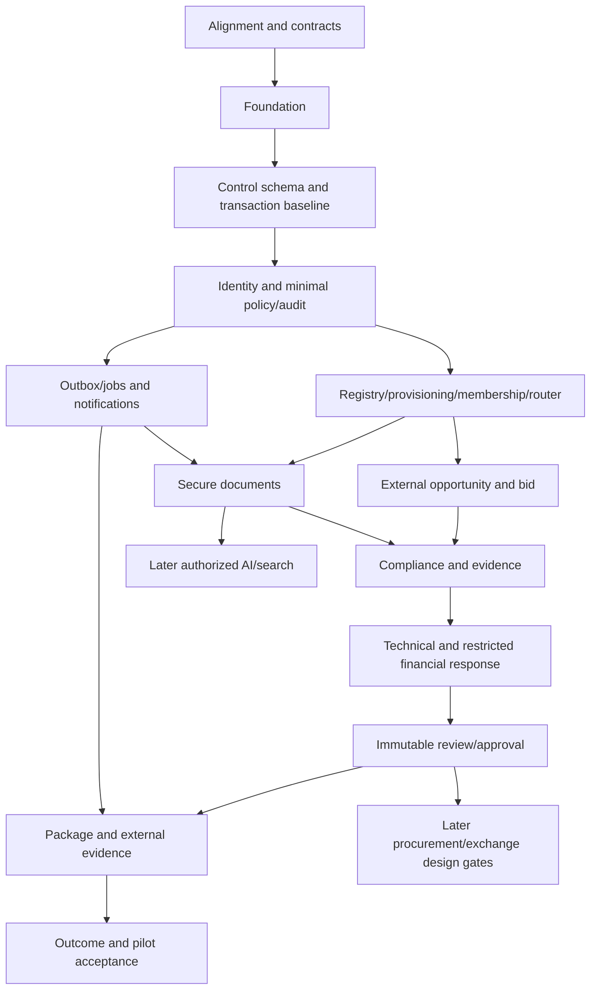

# Dependency matrix

## 1. Purpose
Make prerequisite order explicit and prevent admin features preceding identity or AI preceding deterministic workflows.

## 2. Scope
Implementation phases and external-MVP slices; future exchange/AI gates retained.

## 3. Product specifications
[Module graph](../product/07_MODULE_DEPENDENCIES.md), [delivery waves](../product/17_DELIVERY_PLAN_WAVES_SPRINTS.md), source authority [index](../product/00_MASTER_INDEX.md).

## 4. Technical designs
[System](../technical_design/01_SYSTEM_ARCHITECTURE.md), [modules](../technical_design/09_BACKEND_MODULE_DESIGN.md), [decisions](../technical_design/27_ARCHITECTURE_DECISIONS.md).

## 5. Prerequisites
Every task declares blocked-by IDs and required decisions. An implementation ticket cannot invent a substitute for a missing dependency.

## 6. Required decisions
BID-ADR-018 corrects source ordering: minimal operator identity/policy/audit before exposed M02/M03 operations; full M04 tenant context develops with registry.

## 7. Dependency graph

## 8. Target components
[Backlog](21_IMPLEMENTATION_BACKLOG.md) maps graph nodes to files/owners; [slices](20_VERTICAL_SLICES_ROADMAP.md) maps user outcomes.

## 9. Execution matrix

| Workstream | Must precede | Can proceed in parallel | Blocking evidence |
|---|---|---|---|
| Contract draft | Corresponding handler/client | Domain tests/schema design | Approved shape/policy/errors |
| Identity | Exposed admin/provisioning | Tenant schema design | Verified session/privileged policy tests |
| Tenant router | All private reads/writes | UI primitives | Isolation and pool/registry failure tests |
| Documents | Evidence/package/AI | Manual opportunity | Clean exact-version access tests |
| Approval | Package submission use | Format renderer prototype with synthetic data | Current immutable candidate and role tests |
| Worker durability | Any accepted async feature | Synchronous domain development | Replay/crash/authorization evidence |
| Operations/recovery | Customer data pilot | Every feature slice | Restore/monitoring/on-call evidence |
| Sealing decision | Platform submission/opening | External workflow | Independent crypto/time/recovery approval |

## 10. Domain/security
No dependency bypass through mock admin, shared tenant DB, generic status patch or model-generated approval.

## 11. Database/API/frontend
Within each node: contract approval, schema/query, application/policy, adapter, UI, integrated verification. Phase 4 contract governance does not defer initial contract design.

## 12. Tests
CI should fail forbidden imports and missing required contract generation; ticket review verifies prerequisite evidence. Run prior slice regression when shared policy/storage changes.

## 13. Acceptance
Every scoped command has satisfied prerequisites or is explicitly blocked/deferred; no circular dependency forces unsafe bootstrap.

## 14. Done
Matrix reconciled with backlog, decisions and accepted evidence after each release.

## 15. Risks
Overbuilding all M08 workflow features before first bid; bounded approved policy can deliver partial module without claiming full completion.

## 16. Evidence
Dependency/task IDs, reviewed exceptions, prerequisite test reports and release mapping.

## 17. Exclusions
Calendar promises, hidden mocks for missing foundations, treating future exchange/AI as required local startup services.
