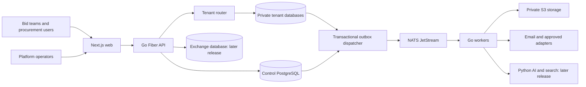

# System architecture

Status: proposed detailed design within approved stack. Sources: [SRD](../product/04_SRD.md) SR-DEP/SR-TEN/SR-SUB, [HLD](../product/08_HLD.md), BR-002/026/043. Governing decisions: [BID-ADR-002–004, 006, 010](27_ARCHITECTURE_DECISIONS.md). Execution: [strategy](../implementation/01_IMPLEMENTATION_STRATEGY.md).

## Boundaries and operating models

Bidora supports external bid preparation independently of a buyer marketplace. Procurement publication, sealed submissions, opening and evaluation are later capabilities, not alternative implementations of external submission tracking. Platform administrators govern metadata but have no implicit access to private tenant content. All decisive approvals, scores and awards remain human-authorized.

## Deployables

- API: session/context, policy, synchronous domain commands, versioned queries. No broker or storage side effect inside a long-held SQL transaction.
- Worker: same Go domain/application code; provisioning, document coordination, packages, notifications, reconciliation. Separate process and least-privileged credentials.
- Web: server-rendered layouts and interactive client workflows; calls Go contracts, never tenant databases.
- Python: parsing/OCR, retrieval, model adapters and evaluations; receives job-scoped authorized references, never arbitrary browser tenant identifiers.
- Control DB owns identity/membership, tenant registry and entitlement metadata. Tenant DB owns bids, drafts, pricing, documents, approvals and evidence. Exchange owns approved public projections and minimum sealed transaction metadata.

## External workflow sequence

Verified identity → resumable organization provisioning → manual external opportunity → verified facts/source version → human Bid/No-Bid → requirements and evidence → restricted technical/financial response → immutable review candidate → approvals → readiness recheck → package job → external action by user → evidence confirmation → reported outcome.

The system records evidence of an external action, not proof it transmitted to or was accepted by an external portal. Reported submission time and server evidence-capture time are distinct.

## Consistency and failure contract

Business changes, tenant audit facts and outbox rows commit together within one database. Cross-plane changes are resumable workflows. Returning 202 means work accepted, not completed. UI reads durable job state. Redis/NATS loss cannot erase authoritative records. Broker replay is at least once, never claimed exactly once. Isolation and membership failures fail closed rather than selecting a default database.

Approved records reference immutable source versions. Later edits create a new candidate and invalidate applicability of old approvals without deleting history. Policy changes and expiry may make a previously approved candidate unready; package/download commands recheck applicable rules.

## Scope and deployment restraint

External-only pilot is pending BID-ADR-006. It needs control/tenant databases, storage, broker, scanner, notifications and authentication controls, but not exchange, Python, vectors or Kubernetes. Compose profiles may omit unused services. Do not create empty microservices to represent future features.

## Future sealed acceptance and recovery (proposed, blocked by BID-ADR-009/010)

Technical attempt states proposed for review: CREATED → PREPARING → PREPARED → ACCEPTING → ACCEPTED, with RETRYABLE_FAILURE, REJECTED and ABANDONED branches. An attempt is not a legally accepted submission. `ACCEPTED` becomes durable only in the exchange transaction containing submission, receipt facts, audit and outbox. Whether the authoritative instant is transaction/commit time, reservation or another governed point requires explicit approval. Never infer on-time acceptance merely from upload start.

| Failure point | Required recovery and user meaning |
|---|---|
| Tenant candidate frozen, before objects prepared | Resume same attempt after current permission and candidate validity check; no receipt yet |
| Objects encrypted, exchange write fails | Retain attempt/object identity; retry validation and conditional acceptance; cleanup only after proving no accepted reference |
| Publication/addendum changes during preparation | Compare authoritative publication version at acceptance; reject stale candidate or require governed reapproval; no eventual search projection decides eligibility |
| Acceptance commits, HTTP response lost | Repeat scoped idempotency request or query receipt; return durable original acceptance, never create another submission |
| Receipt signing temporarily fails | Preserve accepted receipt facts and report signing pending; retry signature idempotently; final acknowledgement semantics require ADR approval |
| Exchange accepted, tenant acknowledgement fails | Replay metadata event/inbox; exchange remains authoritative; tenant must not auto-resubmit |
| Bidder DB restored behind exchange | Reconcile accepted IDs/versions from controlled exchange API; retain immutable receipt lineage |
| KMS unavailable before acceptance/opening | Fail explicitly without plaintext workaround; opening release resumes under fresh quorum/time/assurance policy |

Publication projections and authoritative acceptance state need a serialized/versioned exchange gate so concurrent addendum/cancellation and acceptance cannot both ignore the other. A synchronous precheck followed by an unguarded later insert is insufficient. Define lock order, authority transfer/acknowledgement and deadline incident procedure in the release-specific exchange design before implementing handlers. Opening is a separate release workflow with durable per-envelope release events and no standing pre-opening procurement decryption privilege.

## Verification

Trace one request and one outbox job through correlation IDs. Demonstrate cross-tenant denial, retry after worker crash, honest 202/failed UI states, approval invalidation, and restore-to-new workflow. System readiness requires the [QA architecture](24_QA_TEST_ARCHITECTURE.md), not merely healthy containers.
