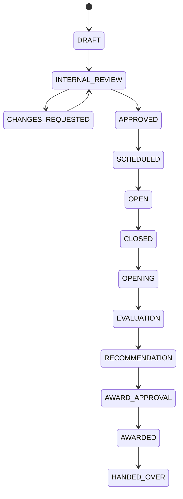
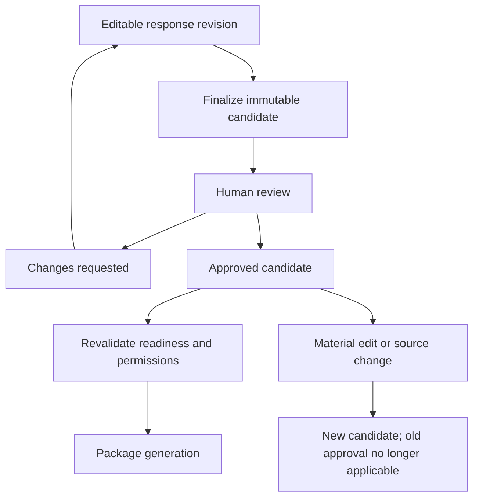

# Domain architecture

Status: design; business-policy gaps remain pending. Sources: [domain model](../product/05_DOMAIN_MODEL_AND_BUSINESS_RULES.md), [journeys](../product/06_USER_JOURNEYS_AND_WORKFLOWS.md). Decisions: [006, 009–012, 018](27_ARCHITECTURE_DECISIONS.md). Execution: [backend](../implementation/06_BACKEND_IMPLEMENTATION.md).

## Aggregate boundaries

| Aggregate | Commands rather than unrestricted CRUD | Invariants |
|---|---|---|
| Tenant | RequestProvisioning, Activate, Suspend | RULE-TEN-001–003: no activation before resources/membership ready; no credential exposure |
| Membership | Invite, Accept, GrantRole, Revoke | RULE-IAM-001–003: validated context; last-admin protection; deny/scope takes precedence |
| Opportunity | CaptureExternal, VerifyFacts, CreateWorkspace | RULE-OPP-001/002: source and verification retained; duplicates not silently merged |
| BidWorkspace | RecordDecision, AssignRequirement, AttachEvidence, FinalizeCandidate | RULE-BID-001–005: one active authoritative tender/lot unless authorized variant; pricing restriction; immutable approved version |
| Document | CompleteUpload, MarkClean, Verify, Supersede, Archive | RULE-DOC-001–004: quarantine, immutable versions, expiry and retrieval authorization |
| ReviewCandidate | SubmitReview, RequestChanges, Approve, InvalidateApplicability | Derived technical aggregate for version-specific approval; never rewrites decision history |
| SubmissionPackage | RequestGeneration, CompleteGeneration, Fail, Reconcile | Exact candidate input; verified manifest; durable retry state |
| ExternalSubmission | RecordEvidence, ConfirmEvidence, MarkSubmitted | PR-TP-013; proof linked to exact package; approved exceptions pending |
| Outcome | RegisterOutcome, CorrectOutcome | PR-TP-014; append-only reported history; lifecycle mapping pending |

## Procurement lifecycle (future)

This illustrates the main path, not a complete transition authorization table. Cancellation/withdrawal/no-award transitions and exceptions must be approved before their handlers exist. Published criteria and versions remain immutable (RULE-TEN-013/015); no AI final score or award (RULE-EVAL-004, RULE-AWD-002).

## Version-specific review

Finalization must snapshot response, tender facts, requirement/evidence versions and policy. It does not approve anything. Approval, readiness and package success are separate states. Current permissions, expiry and material source changes can block use of an existing package without erasing historical evidence.

## Temporal semantics

Store instants in UTC and original zone/source wording. Separate `submission_opens_at`, `submission_closes_at`, `bid_opening_not_before` (BID-ADR-009). External evidence has `reported_submitted_at` and server `recorded_at`. Late evidence capture is not automatically a late external submission. UI never computes authoritative permission from its clock.

## Concurrency and consistency

Commands carry actor, validated tenant context, expected aggregate version, correlation and idempotency where applicable. The application obtains one DB lease, reads/locks required aggregate rows, checks policy, applies transition, writes audit/outbox and commits. Concurrent edit versus approve must have exactly one winner for a specific expected version. No scan/KMS/network calls in that transaction.

## Verification

Use table-driven valid/invalid transition tests, race tests for approve/edit and last-admin removal, property tests for decimal calculations and dates, and API negative tests. Pending policy transitions must fail closed rather than be inferred from the diagram. See [schema](06_DATABASE_SCHEMA_DESIGN.md) and [modules](09_BACKEND_MODULE_DESIGN.md).
