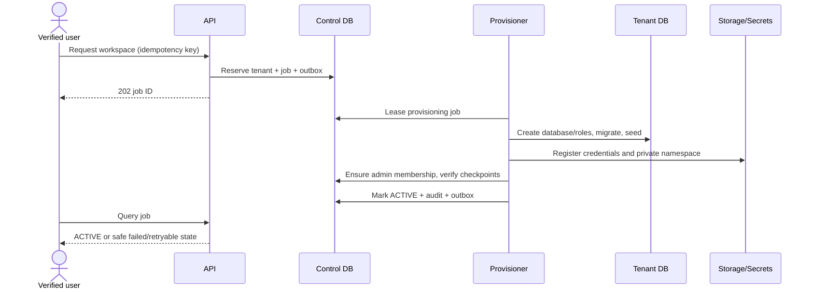

# Multi-tenancy design

Sources: [SRD](../product/04_SRD.md) SR-TEN-001–008, [domain](../product/05_DOMAIN_MODEL_AND_BUSINESS_RULES.md) RULE-IAM-001, [security §7](../product/14_SECURITY_PRIVACY_COMPLIANCE.md). Decisions: [003, 007, 018](27_ARCHITECTURE_DECISIONS.md). Execution: [provisioning](../implementation/09_TENANT_PROVISIONING.md).

## Routing protocol

1. Authenticate the session; validate expiry, revocation and assurance.
2. Resolve selected workspace and active membership in the control plane. A request context selector must match the selected authorized context; stale multi-tab writes return a context conflict, never route to a newly selected tenant silently.
3. Evaluate tenant status and effective capabilities. Local tenant user projections do not independently grant membership.
4. Resolve registry assignment using server-owned IDs; verify schema compatibility and placement generation.
5. Acquire a bounded tenant-specific DB lease, using tenant credentials from the secrets adapter.
6. Authorize resource/state/classification in the owning application use case. Release the lease after transaction/query.

Unknown, suspended, incompatible or unavailable tenant fails closed. There is no default database. Database-per-tenant does not substitute for row/resource authorization within that tenant. SQL identifiers cannot come from browser input.

## Provisioning sequence

Each checkpoint records deterministic resource IDs and completion evidence. Retry checks ownership before adopting an existing DB/bucket namespace. A name collision is not success. Failure leaves tenant non-active; cleanup is a reviewed workflow, not blind deletion. Runtime API credentials cannot create databases or read all tenant secrets.

## Connection management

Budget per cluster = API replicas × active pools per replica × pool maximum, plus workers, migrations, backup and reserved admin capacity. Agree measured limits before production. Lazy pools have LRU idle eviction and lease reference counting; active leases cannot be evicted. Registry reassignment/credential rotation increments generation and drains old pools. PgBouncer mode must be tested with pgx prepared statements and session settings. Never use session-local state that can survive into another tenant connection.

## Cross-plane projection and revocation

Membership authoritative state remains in control DB. Tenant user rows retain assignment/audit identity, not unrestricted current access. Sensitive commands and worker execution revalidate membership; caches require bounded TTL plus invalidation and may not serve allow decisions during unknown revocation state. Policy freshness guarantees must be approved with identity ADR. A platform operator gets only metadata unless an approved, scoped, expiring support grant exists.

## Acceptance

Test two tenants of each supported type with identical UUID-shaped records; forged header, switched context during request, revoked user during queued job, credential rotation, unavailable registry, wrong schema, pool churn, and restored database placement. Verify objects, caches, logs, search and receipts, not only SQL. No browser response includes database locator/secret reference. Tenant suspension blocks writes except explicitly approved remediation paths; their policy is pending, not universally allowed.
