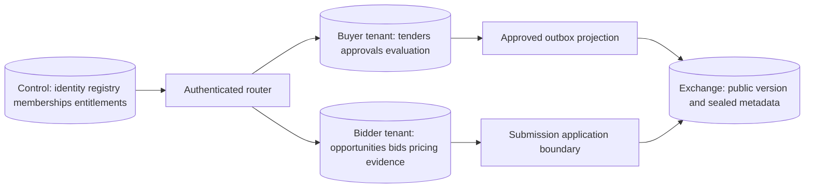

# Database architecture

Sources: [database design](../product/10_DATABASE_DESIGN.md), [SRD](../product/04_SRD.md) DATA-001–008. Decisions: [003, 008, 010](27_ARCHITECTURE_DECISIONS.md). Execution: [database workstream](../implementation/05_DATABASE_IMPLEMENTATION.md).

## Ownership

Arrows are application/event calls, not cross-database foreign keys or joins. Control-plane identity references inside tenant records are logical UUID references validated by application services; preserve historical actor attribution after account closure. Exchange IDs are external references in tenant records and require reconciliation.

## Data representation

Proposed application-generated UUIDv7 IDs; no user-visible meaning derived from them. Confirm library/runtime support before approval. Use `numeric(20,4)` and ISO currency, never floating-point for money; `timestamptz` plus source IANA zone/text for deadlines. API decimals are strings. Mutable aggregates have `version bigint >= 1`; immutable version rows have a revision unique within their parent. JSONB is for versioned manifests/configuration, not a substitute for requirements, prices or evidence relationships.

## Transaction model

Same-database authoritative change, audit and outbox commit atomically. Aggregate version update is conditional; no affected row means stale version. A transaction-scoped repository cannot silently fall back to a pool. Same-tenant cross-module composition uses explicit application ports and one unit of work; direct foreign-table reads remain prohibited. Multi-database operations use sagas/checkpoints, never nested pseudo-transactions.

## Security and lifecycle

Runtime roles have no DDL, role creation or audit update/delete. Provisioner, migrator, backup and read-only reporting roles are separate. Database owner privileges are unavailable to request handlers. TLS and certificate validation apply outside isolated local development. Cross-tenant restore uses a new assignment, never overwrites another tenant DB.

Archive is a domain transition; `deleted_at` is not a retention policy. Approved versions/evidence cannot be physically overwritten. Retention hold records and classified erasure jobs govern removal of DB, object versions, indexes and exports. Backup expiry is documented separately; do not promise instantaneous deletion from historical backups.

## Query/index discipline

Use owner-scoped cursor queries ordered by `(created_at,id)` or explicit stable business order. Index foreign keys and actual filters: open bids by state/deadline, requirements by bid/status, jobs by next attempt, audit by target/time. Partial unique indexes enforce one active workspace when authoritative tender/lot identity is known; external reference normalization and variant rules require product approval. Do not deduplicate on title alone.

## Verification

[Schema catalogue](06_DATABASE_SCHEMA_DESIGN.md) defines core major tables. [Migration design](07_DATABASE_MIGRATIONS.md) defines rollout. EXPLAIN plans and representative cardinalities are evidence, not guessed indexes on every column. Test rollback of command/audit/outbox together, stale writes, denied audit mutation, and isolation under restored/rotated connections.
