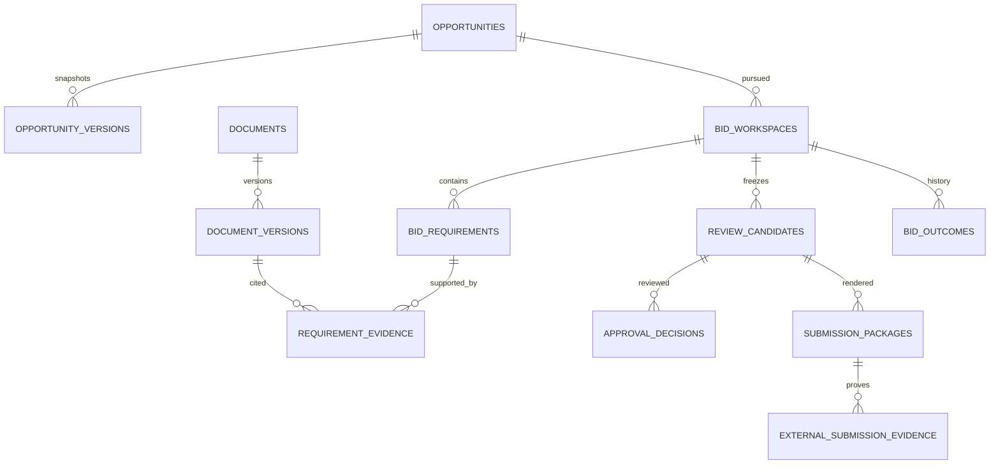

# PostgreSQL schema design

Status: proposed engineering schema, not executed migrations. Sources: [database specification](../product/10_DATABASE_DESIGN.md), [domain rules](../product/05_DOMAIN_MODEL_AND_BUSINESS_RULES.md), PR-TP-004–014 in [PRD](../product/03_PRD.md). Decisions: [003, 008–012, 015, 017](27_ARCHITECTURE_DECISIONS.md). Execution: [database implementation](../implementation/05_DATABASE_IMPLEMENTATION.md).

## Option A inventory and executable bounded slices — 2026-10-18

The [machine-readable Option A inventory](../../backend/schema/option-a-tables.json) enumerates 52 required control/Tenderpreneur-tenant tables with explicit implementation/gate status. It excludes future procurement, exchange and AI/search databases. Inventory is planning/traceability, not blanket approval for blocked tables.

A provider-neutral control slice is executable: control compatibility, Tenderpreneur tenants, database clusters, one-active database assignments, per-tenant schema-version states, append-only control audit and immutable outbox facts. It contains no credential/session/membership tables, creates no database/role and stores only endpoint/secret references. Typed routing requires ACTIVE tenant/cluster, matching assignment generation and compatible common/Tenderpreneur schema rows. Membership must be validated separately before routing. The tenant-common executable slice now also includes a singleton organization profile, local user projections for ownership/display, and immutable payload-free inbox receipts. Projections are historical/local references and never authorization. Inbox uniqueness prevents repeated database effects only when receipt/effects share one transaction; external effects still require reconciliation.

## Executable bounded capture slice — 2026-10-18

The user authorized database-design execution/backend foundations after approving manual-capture request semantics. For that operation only, [the executable foundation](../../backend/docs/database-foundation.md) refines the proposed opportunity rows below:

- tenant-common schemas: append-only audit, outbox with immutable facts and operational delivery fields, and no-TTL capture idempotency;
- Tenderpreneur schema: mutable opportunity root plus immutable `UNVERIFIED` source versions, preserving null/raw source facts and canonical request hash;
- composite current-source FK prevents linking a source version owned by another opportunity;
- typed parameterized capture queries generated by sqlc v1.31.1 for pgx/v5.

This narrow refinement supersedes the denormalized `opportunities`/verified-only `opportunity_versions` description **for initial unverified capture only**. Verification may append a later source version after its own contract; it may not rewrite the captured version. `source_document_version_id` remains a logical UUID until BID-DB-005 supplies the local document FK, so non-null document capture cannot be activated. No other proposed table below became executable or approved. Goose/sqlc validation passed, but no migration ran against PostgreSQL; status is IMPLEMENTED_NOT_DATABASE_VERIFIED.

## Notation and inherited contract

`!` means NOT NULL; `?` nullable. Unless explicitly overridden, every table below has `id uuid! PK`, `created_at timestamptz!`, `created_by uuid?` (logical actor reference). Mutable aggregate roots additionally have `version bigint! DEFAULT 1 CHECK(version>0)` and `updated_at timestamptz!`. Immutable children do not inherit mutable columns. UUID references are local FKs only when both tables are in the same database. All FK deletions default RESTRICT; cascade is allowed only for explicitly approved disposable draft children, never approved evidence.

All hashes are `bytea` with `octet_length=32` for SHA-256 unless algorithm/version is explicitly stored. SQL status checks enumerate the approved domain states; pending business states are not finalized by this table. Currency is `char(3)` validated against versioned ISO reference data; amounts `numeric(20,4)`. Each table entry specifies its additional columns, keys, query indexes, lifecycle, security and relationships; common columns above are part of every definition.

## Control database

| Table / purpose | Columns beyond common contract | Keys, constraints, indexes and relationships | Lifecycle / security |
|---|---|---|---|
| identity.users — person | email_normalized text!, display_name text!, verified_at timestamptz?, state text!, auth_epoch bigint! | Unique email_normalized; email normalization policy must be approved, not arbitrary provider-specific rewriting | Mutable; user state/auth_epoch revokes sessions; no private bid content |
| identity.password_credentials — optional password auth | user_id uuid!, hash text!, changed_at timestamptz! | FK users, unique user_id; Argon2id encoded hash only | Restricted identity adapter; no hash in DTO/log; conditional on ADR-007 |
| identity.challenges — verification/recovery | user_id uuid?, purpose text!, token_hash bytea!, expires_at timestamptz!, consumed_at timestamptz?, attempts integer! | Unique token_hash; FK users when known; attempts>=0; index expires_at for expiry | Single-use conditional consume; limited retention; anti-enumeration response |
| identity.mfa_methods — enrolled factor | user_id uuid!, kind text!, encrypted_secret_ref text?, verified_at timestamptz?, revoked_at timestamptz? | FK users; active-factor query index user_id | Secret reference or encrypted material only; recovery codes stored as one-way hashes in separate factor records |
| identity.sessions — opaque session | user_id uuid!, token_hash bytea!, expires_at timestamptz!, idle_expires_at timestamptz!, revoked_at timestamptz?, auth_epoch bigint!, assurance text!, active_tenant_id uuid?, context_generation bigint! | FK users and tenancy.tenants; unique token_hash; index user_id/expires_at | Mutable rotation/revocation; token never stored plaintext; selected tenant is not proof of membership |
| tenancy.tenants — registry root | type text!, state text!, name text!, country char(2)!, timezone text!, locale text!, assignment_generation bigint! | Type PROCUREMENT/TENDERPRENEUR until hybrid approved; lifecycle SR-TEN-001; index state/created_at | ACTIVE only after resource and member verification; control metadata only |
| tenancy.assignments — database placement | tenant_id uuid!, cluster_id uuid!, database_name text!, secret_ref text!, generation bigint!, active boolean! | FK tenants/clusters; unique cluster_id/database_name; partial unique tenant_id where active | Operator/provisioner only; never expose locators to browser |
| tenancy.clusters — cluster registry | region text!, endpoint_ref text!, capacity_policy jsonb!, state text! | Endpoint is secret/config reference; no user-selected endpoint | Operations-only placement metadata; rotate references with generation |
| tenancy.provisioning_jobs — resumable lifecycle | tenant_id uuid!, state text!, checkpoint text!, lease_until timestamptz?, attempts integer!, next_attempt_at timestamptz!, error_code text? | FK tenants; unique active creation job per tenant; partial index next_attempt_at for retryable jobs | Durable checkpoints; cleanup only verified owned resources |
| tenancy.memberships — authorization authority | tenant_id uuid!, user_id uuid!, state text!, policy_version bigint! | FKs tenants/users; unique tenant_id/user_id; user_id/state index | Last-admin invariant checked under serialized tenant policy lock |
| tenancy.role_grants — scoped grants | membership_id uuid!, capability text!, scope jsonb!, effect text!, policy_version bigint! | FK memberships; effect ALLOW/DENY; canonical grant unique by membership/capability/scope/effect | Audited grant/revoke; scope is typed versioned schema, not arbitrary executable expression |
| tenancy.invitations — team onboarding | tenant_id uuid!, email_normalized text!, token_hash bytea!, expires_at timestamptz!, accepted_by uuid?, consumed_at timestamptz? | FKs tenant/user; unique token_hash; index tenant/email | Role selection stored in governed invitation grants; invite does not confer access before acceptance |
| tenancy.schema_versions — fleet state | tenant_id uuid!, migration_set text!, current_version bigint!, target_version bigint?, state text!, checksum text! | FK tenants; unique tenant_id/migration_set | Migrator-owned; compatibility checked by router |
| subscription.entitlements — versioned plan grant | tenant_id uuid!, feature text!, limit_value bigint?, policy_version bigint!, effective_at timestamptz! | FK tenants; unique tenant/feature/policy_version; nonnegative limits | Immutable versions; null limit meaning must be explicit in contract; commercial values pending |
| subscription.usage_ledger — usage facts | tenant_id uuid!, operation_id uuid!, meter text!, quantity numeric(20,4)!, reservation_state text! | FK tenants; unique operation_id/meter; tenant/meter/time index | Append-oriented reservations/settlement; concurrency-safe quotas; no private document metadata |

Identity service must implement external identity mapping instead of password credentials when OIDC is selected. Exact OIDC factor/session schema is blocked by ADR-007; do not scaffold both auth systems speculatively.

## Common tenant database

| Table / purpose | Columns beyond common contract | Keys, constraints, indexes and relationships | Lifecycle / security |
|---|---|---|---|
| organization_profile — organization settings | legal_name text!, country char(2)!, timezone text!, currency char(3)!, policy_version bigint! | One organization row per database, enforced by singleton key | Tenant administrators; no membership authority here |
| tenant_user_profiles — assignment projection | identity_id uuid!, display_name text!, membership_state text!, projection_version bigint! | Unique identity_id; logical control-plane reference | Historical assignments retained; stale ACTIVE projection never grants access |
| documents — logical evidence/source | title text!, classification text!, owner_id uuid!, state text!, archived_at timestamptz? | owner_id FK tenant_user_profiles; owner/state index | Mutable metadata; archive does not erase version evidence |
| document_versions — immutable bytes identity | document_id uuid!, revision integer!, object_ref text!, storage_version text!, sha256 bytea!, byte_size bigint!, detected_type text!, issue_date date?, expiry_date date?, scan_state text!, available_at timestamptz? | FK documents; unique document/revision; unique object_ref/storage_version; size>0; expiry>=issue when both known; AVAILABLE requires CLEAN | Bytes/object binding immutable; operational scan transition separate from content; private object reference never browser authority |
| document_verifications — human findings | document_version_id uuid!, verdict text!, reason text?, verified_by uuid!, verified_at timestamptz! | FKs version/profile; version/time index | Append-only corrections; verification does not override malware failure |
| upload_sessions — quarantined transfer | document_id uuid?, expected_size bigint!, expected_type text!, object_ref text!, state text!, expires_at timestamptz!, completed_version_id uuid? | FKs documents/version; unique object_ref; positive bounded size | Server-owned key; bound initiating actor; immutable destination after completion |
| retention_holds — no-delete policy | target_type text!, target_id uuid!, reason text!, effective_at timestamptz!, released_at timestamptz? | Polymorphic target validated by owning module, not fake cross-table FK; active target index | Restricted legal/retention authority; release audited |
| audit_events — business history | actor_id uuid?, action text!, target_type text!, target_id uuid!, occurred_at timestamptz!, outcome text!, correlation_id uuid!, change_summary jsonb!, policy_version bigint? | target/time/id and correlation indexes | Append-only grants; minimal classification-safe summary; no raw bid text/tokens |
| outbox_events — durable event facts | aggregate_type text!, aggregate_id uuid!, aggregate_version bigint!, event_type text!, schema_version integer!, payload jsonb!, occurred_at timestamptz!, published_at timestamptz?, attempts integer!, next_attempt_at timestamptz! | id is event ID; pending next_attempt_at partial index; aggregate/version index | Immutable payload; delivery fields updated by dispatcher; lease protocol |
| inbox_events — consumer receipts | consumer text!, event_id uuid!, state text!, processed_at timestamptz? | Unique consumer/event_id | Same transaction as DB effects; external effects need separate state/reconciliation |
| idempotency_records — command deduplication | actor_id uuid!, operation text!, key_hash bytea!, request_hash bytea!, state text!, response_status integer?, response_ref uuid?, expires_at timestamptz! | Unique actor/operation/key_hash; tenant implicit in DB | Safe result reference only; reauthorize replay; expiry must not permit duplicate irreversible commands |
| jobs — async operation | kind text!, input_ref uuid!, requester_id uuid!, state text!, lease_until timestamptz?, attempts integer!, next_attempt_at timestamptz!, result_ref uuid?, error_code text? | input/requester logical or owned FK as applicable; pending index next_attempt_at | Worker reauthorizes execution; safe error codes; cancellation checkpoints |

Control and exchange databases have analogous plane-local audit/outbox/inbox/idempotency tables. Their rows include explicit tenant IDs where applicable because those databases are shared. They never contain private drafts in event payloads.

## Tenderpreneur tenant database

| Table / purpose | Columns beyond common contract | Keys, constraints, indexes and relationships | Lifecycle / security |
|---|---|---|---|
| opportunities — external tender root | title text!, buyer_name text!, source_kind text!, source_uri text?, source_document_version_id uuid?, verification_state text!, closes_at timestamptz?, source_timezone text?, source_date_text text? | FK document_versions; index closes_at/state; URI display only until safe connector exists | Facts require explicit verification; ambiguous dates remain unverified |
| opportunity_versions — verified snapshot | opportunity_id uuid!, revision integer!, facts jsonb!, source_refs jsonb!, verified_by uuid!, verified_at timestamptz! | FK opportunities/profile; unique opportunity/revision; facts/source schemas versioned | Immutable exact source snapshot; no invented AI fields |
| bid_workspaces — bid aggregate | opportunity_id uuid!, source_version_id uuid!, owner_id uuid!, state text!, authoritative_key text?, lot_key text?, variant_key text?, archived_at timestamptz? | FKs opportunities/version/profile; state/deadline via approved query model; active unique authoritative_key/normalized lot/variant when known | RULE-BID-001; unknown external identities are duplicate candidates, not hard title-based uniqueness |
| bid_decisions — human bid/no-bid | bid_id uuid!, decision text!, rationale text!, actor_id uuid!, decided_at timestamptz! | FKs bid/profile; bid/time index | Append-only; permitted decisions and defer mapping reviewed against domain lifecycle |
| bid_requirements — compliance item | bid_id uuid!, text text!, source_document_version_id uuid!, source_location text!, mandatory boolean!, category text!, status text!, owner_id uuid?, due_at timestamptz?, verification_state text! | FKs bid/document version/profile; bid/status and owner/due indexes | SATISFIED requires valid evidence or approved response; waived/not-applicable policy pending |
| requirement_evidence — exact link | requirement_id uuid!, document_version_id uuid?, response_version_id uuid?, verification_id uuid? | Local FKs; exactly one evidence target using CHECK; unique requirement/target; no cascade | Never point to 'latest'; permission and expiry checked at use time |
| response_sections — editable logical section | bid_id uuid!, title text!, classification text!, position integer! | FK bid; unique bid/position | Versioned content; technical and financial access separate |
| response_versions — immutable content revision | section_id uuid!, revision integer!, content text!, format text!, content_hash bytea! | FK sections; unique section/revision | Append-only content; renderer sanitizes; format allowlist |
| financial_responses — pricing root | bid_id uuid!, currency char(3)!, state text! | FK bid; unique bid for MVP one schedule, multi-schedule later | Separate capability; decimal arithmetic and approval policy |
| financial_lines — versioned pricing line | financial_response_id uuid!, revision integer!, line_key text!, description text!, quantity numeric(20,4)!, unit_price numeric(20,4)!, tax_amount numeric(20,4)! | FK financial_responses; unique response/revision/line_key; numeric sign/rounding rules pending tender policy | Immutable revision lines; do not infer totals using binary floats |
| review_candidates — frozen approval input | bid_id uuid!, revision integer!, source_version_id uuid!, manifest jsonb!, manifest_hash bytea!, policy_version bigint! | FKs bid/source version; unique bid/revision; manifest references validated same DB | Immutable source/requirement/evidence/response/pricing snapshot; schema-versioned manifest |
| approval_decisions — accountable review | candidate_id uuid!, step_key text!, actor_id uuid!, decision text!, reason text?, decided_at timestamptz!, policy_version bigint! | FKs candidate/profile; unique candidate/step/actor for one decision attempt; correction requires new governed attempt | Append-only; membership/assurance verified when committed |
| approval_applicability — current applicability | candidate_id uuid!, state text!, invalidated_at timestamptz?, cause_ref uuid? | FK candidates; unique candidate | Mutable projection; cannot alter original decision; newer revision/source/expiry can invalidate |
| readiness_results — deterministic check | candidate_id uuid!, evaluated_at timestamptz!, policy_version bigint!, blockers jsonb!, warnings jsonb!, input_hash bytea! | FK candidate; candidate/time index | Immutable result; not everlasting authorization to submit |
| submission_packages — generated artifact | candidate_id uuid!, job_id uuid!, generation_fingerprint bytea!, state text!, manifest_hash bytea?, object_ref text?, storage_version text?, package_hash bytea?, generated_at timestamptz? | FKs candidate/jobs; unique candidate_id/generation_fingerprint; fingerprint is SHA-256 of canonical candidate hash + renderer version + format profile; success requires all artifact fields | Immutable successful artifact; restricted to combined content classification |
| external_submission_evidence — proof record | bid_id uuid!, package_id uuid!, proof_document_version_id uuid!, channel text!, external_reference text?, reported_submitted_at timestamptz!, recorded_at timestamptz!, state text! | FKs bid/package/proof; ensure package belongs to bid via composite key or transaction validation; index bid/recorded_at | Append-only proof; confirmation as separate event; server capture time not external receipt |
| evidence_confirmations — human confirmation | evidence_id uuid!, actor_id uuid!, verdict text!, reason text?, confirmed_at timestamptz! | FKs evidence/profile; evidence/time index | Append-only; cannot confirm own evidence if approved policy disallows |
| bid_outcomes — reported history | bid_id uuid!, outcome text!, reason text?, evidence_version_id uuid?, reported_at timestamptz!, supersedes_id uuid? | FKs bid/document version/self; bid/time index; correction chain cycle prevented in use case | Append-only; won/lost/etc mapping pending ADR-012 |

Before executable DDL, approve renderer/manifest canonicalization and the format profile used to compute `generation_fingerprint`. The column and uniqueness contract are defined above; the canonical byte encoding is a design blocker, not a hidden runtime assumption. `submission_packages` is mutable only while processing; successful artifact identity/hash fields cannot be updated by runtime roles. To regenerate with different inputs or renderer configuration, create a new fingerprint/row.

## Relationships



## Future procurement and exchange major tables

These are bounded preliminary designs, not permission to implement closed-loop tendering. Full criterion, quorum, finance-stage and legal-retention schemas remain blocked by approved procedure policies.

| Table / database | Columns beyond common contract | Keys / indexes / lifecycle / security |
|---|---|---|
| tenders / procurement tenant | reference text!, period text!, state text!, published_version_id uuid?, submission_opens_at timestamptz?, submission_closes_at timestamptz!, bid_opening_not_before timestamptz? | Unique reference/period; future local FK published version; state/deadline index; transitions authorized, timestamp boundary ADR-009 |
| tender_versions / procurement tenant | tender_id uuid!, revision integer!, scope text!, approval_candidate_id uuid?, manifest_hash bytea! | FK tenders; unique tender/revision; immutable published revision; approval FK requires local procurement workflow schema |
| evaluation_criteria / procurement tenant | tender_version_id uuid!, lot_key text!, code text!, wording text!, weight numeric(8,4)!, max_score numeric(12,4)! | FK tender_versions; unique version/lot/code; weight>=0, max_score>0; sum validation in publication command; immutable after publication |
| public_tender_versions / exchange | buyer_tenant_id uuid!, origin_version_id uuid!, revision integer!, public_manifest jsonb!, manifest_hash bytea!, published_at timestamptz! | Logical tenant/origin references; unique buyer/origin; public projection only; no internal budgets or notes |
| submission_attempts / exchange | bidder_tenant_id uuid!, publication_version_id uuid!, request_hash bytea!, state text!, prepared_manifest_hash bytea?, accepted_submission_id uuid? | FK public version; scoped idempotency unique key; pending-attempt query; private metadata; durable recovery states |
| submissions / exchange | publication_version_id uuid!, bidder_tenant_id uuid!, final_response_ref uuid!, manifest_hash bytea!, accepted_at timestamptz!, receipt_facts jsonb!, prior_submission_id uuid? | Local FK public version/self; accepted_at authoritative policy pending; bidder/publication index; immutable acceptance |
| submission_envelopes / exchange | submission_id uuid!, object_ref text!, storage_version text!, ciphertext_hash bytea!, wrapped_key_ref text!, crypto_scheme_version text! | FK submissions; unique object/version; immutable encrypted references; no plaintext keys or content; ADR-010 blocker |
| opening_release_events / exchange | submission_id uuid!, authorization_ref uuid!, released_at timestamptz!, actor_id uuid!, policy_hash bytea! | FK submissions; unique submission/authorization; append-only release evidence; release authority separated from ordinary procurement runtime |

## Illustrative DDL — not an executable migration

```sql
CREATE TABLE approval_decisions (
    id uuid PRIMARY KEY,
    created_at timestamptz NOT NULL,
    created_by uuid,
    candidate_id uuid NOT NULL REFERENCES review_candidates(id),
    step_key text NOT NULL,
    actor_id uuid NOT NULL REFERENCES tenant_user_profiles(id),
    decision text NOT NULL CHECK (decision IN ('APPROVE','REQUEST_CHANGES','REJECT')),
    reason text,
    decided_at timestamptz NOT NULL,
    policy_version bigint NOT NULL CHECK (policy_version > 0),
    UNIQUE (candidate_id, step_key, actor_id)
);
-- Runtime role receives INSERT/SELECT only; corrections require new governed attempt.
```

## Verification and remaining detail gates

Test all uniqueness/FKs/checks with real PostgreSQL; generated SQL must use parameters. Test audit mutation denial, exactly-one evidence target, stale version conflict, approval/edit races and package/bid mismatch. Prototype permission-scoped pricing queries. Detailed full-platform tables not enumerated here (planning, moderation, awards, AI evaluation stores, payment invoices) require a release-specific schema extension before implementation; their ownership remains the product database catalogue, not invented generic JSON stores.
