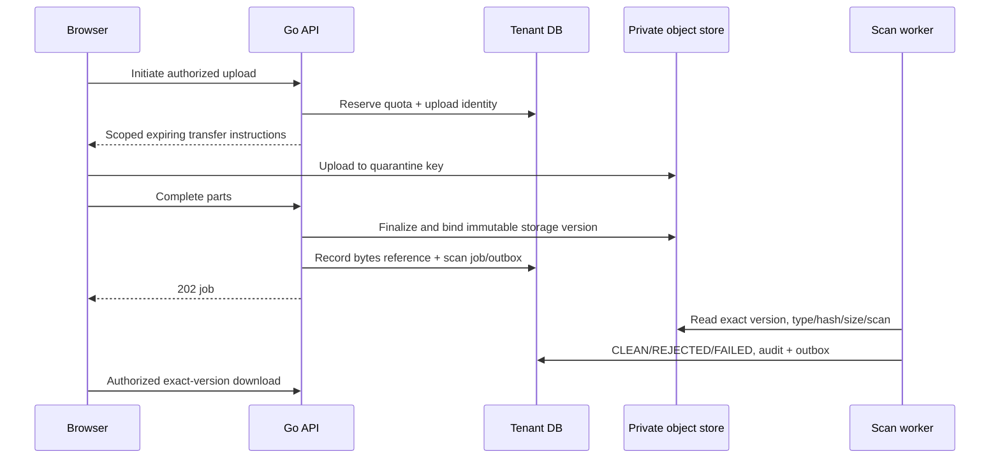

# Document storage design

Sources: [security §9](../product/14_SECURITY_PRIVACY_COMPLIANCE.md), [API §16](../product/11_BACKEND_API_DESIGN.md), RULE-DOC-001–004. Decisions [004, 017](27_ARCHITECTURE_DECISIONS.md). Execution: [document implementation](../implementation/11_DOCUMENT_STORAGE_IMPLEMENTATION.md).

## Upload protocol

Never scan a mutable key then serve later replacement bytes. Bind storage version and checksum at finalization; promote by immutable copy or version-bound reference only after verification. Client checksums/types are hints. CompleteUpload retries adopt only the same owned version. Storage success with DB failure is reconciled using upload ID; orphan cleanup waits for an approved safety window and checks live references/holds.

## Object identity and access

Server generates opaque keys under tenant/private, quarantine and export namespaces. Namespaces alone are not security: provider policy and application authorization both apply. Public tender artifacts use a separate future namespace copied only from approved publication projection. Signed URLs scope exact object version/action and short expiry. Highly sensitive pricing/exports may require streaming authorization if revocation latency cannot tolerate URL TTL.

## Processing controls

Format/size/page/archive-depth limits are pending ADR-017. Until approved, unsupported inputs are rejected, not passed to arbitrary parsers. Scanner outage leaves QUARANTINED, never CLEAN. Renderers/parsers run without privileged credentials or unrestricted network, with CPU/memory/time limits. Disable active content/macros and sanitize previews; Content-Disposition and MIME protection prevent inline executable uploads. ZIP input is not automatically allowed because package output is ZIP.

## Evidence and package generation

Document logical record and immutable byte version are separate. Evidence cites version and source location. Candidate manifests freeze exact files, response/pricing revisions and policy. Renderer uses a versioned format profile, canonical manifest encoding and generation fingerprint; those choices require approval. Store file hashes and package hash. Worker retries reconcile durable job state and existing artifact; success requires verified object plus committed metadata. Material source/evidence changes invalidate applicability, not historical bytes.

## Retention and recovery

Archive is not deletion. Retention/hold policy governs database metadata, all object versions, exports and derived previews. Backup and object version reconciliation is part of restore. Prevent lifecycle expiry of objects still referenced by approved evidence. Test interrupted multipart, wrong owner, overwritten key, malformed file, scan failure, expired evidence, signed URL scope, hash mismatch and package storage/DB split failure.
