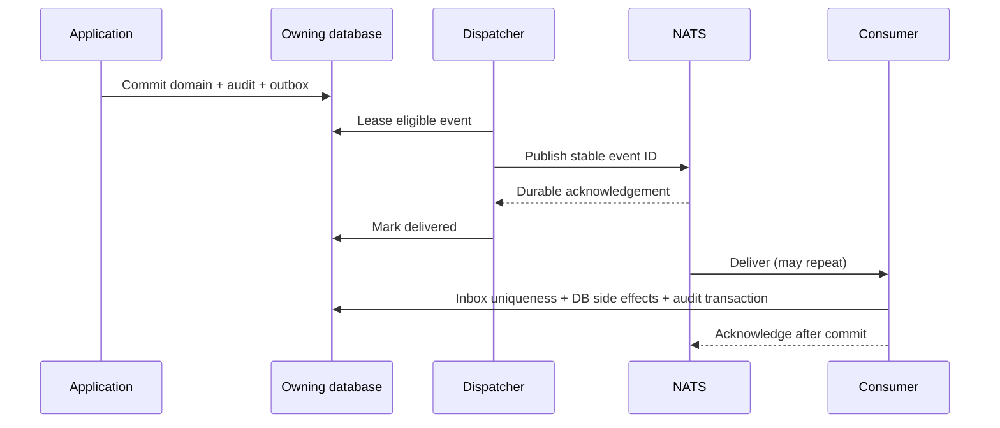

# Event and messaging design

Sources: [HLD §7](../product/08_HLD.md), [LLD §12](../product/09_LLD.md), SR-EVT-001–005. Decisions [004, 010](27_ARCHITECTURE_DECISIONS.md). Execution: [workers](../implementation/12_EVENTS_WORKERS_IMPLEMENTATION.md).

## Envelope and schemas

Proposed future AsyncAPI message envelope:

```json
{
  "event_id": "019c0000-0000-7000-8000-000000000001",
  "event_type": "bid.candidate_finalized",
  "schema_version": 1,
  "tenant_id": "019c0000-0000-7000-8000-000000000002",
  "aggregate_type": "bid",
  "aggregate_id": "019c0000-0000-7000-8000-000000000003",
  "aggregate_version": 7,
  "occurred_at": "2027-03-01T10:00:00Z",
  "correlation_id": "019c0000-0000-7000-8000-000000000004",
  "causation_id": null,
  "actor_id": "019c0000-0000-7000-8000-000000000005",
  "classification": "INTERNAL",
  "payload": {"candidate_id": "019c0000-0000-7000-8000-000000000006"}
}
```

UUID/time/version fields are required; payload schema is event-specific and allowlisted. Actor is audit provenance, not a bearer credential. Worker reconstructs current authorization and resolves references through owning ports. No raw pricing, document bytes, tokens or secret object paths in broker payloads.

## Delivery sequence



Dispatcher crash after publish causes repeat, not loss. Consumer crash before commit rolls back inbox/effects; after commit before ack repeats safely. Inbox dedup alone does not make S3/email exactly once: record external operation state, provider idempotency identity and reconciliation result separately.

## Catalogue

| Event | Producer → consumer | Minimum payload / ordering rule |
|---|---|---|
| tenant.provisioning_requested | Control → provisioner | tenant/job IDs; checkpoint retry |
| membership.revoked | Identity → cache/jobs | membership/policy version; never let stale event regrant |
| document.scan_requested | Documents → scanner | upload/document version IDs; exact immutable bytes |
| document.available | Documents → bid/readiness | version ID; recompute eligibility, not automatic SATISFIED |
| bid.candidate_finalized | Bid → workflow/notification | candidate ID; version-monotonic projection |
| bid.approval_invalidated | Workflow → UI/readiness projections | candidate/cause IDs; command checks remain authoritative |
| package.requested | Package → renderer | candidate/job/fingerprint references |
| external_submission.recorded | Bid → reporting/notification | evidence/bid IDs; never imply external delivery |
| tender.published / addendum.published | Buyer → exchange and linked bidders, later | approved manifest reference/hash; monotonic publication version |
| submission.accepted | Exchange → bidder/buyer metadata, later | receipt/submission IDs; no content before release |

## Retry, ordering and operations

NATS subjects separate platform, tenant lifecycle, document, bidder, exchange and AI workloads with service ACLs. Do not put unbounded tenant IDs into metric labels. Use durable consumers, explicit ack, bounded backoff/jitter and dead-letter policy; operator replay is audited and scoped. Payload schema incompatibility goes to quarantine, not infinite retry. Aggregate versions reject stale projections; gaps trigger replay/rebuild, not invented intermediate facts. DB fleet dispatch uses bounded leases and fair scheduling, not scanning every tenant in an unbounded tight loop.

## Acceptance

Fault-inject commit/publish/ack boundaries; replay duplicate/out-of-order events; verify no unauthorized result exposure, no duplicate approval/evidence, and outbox lag alerts. Retention/replay windows must be approved so inbox expiry cannot permit historical side-effect duplication.
