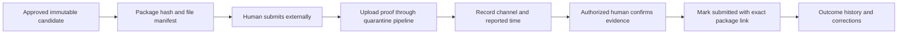

# Audit, logging and evidence

Sources: BR-050, PR-SH-008, [security §§14–15](../product/14_SECURITY_PRIVACY_COMPLIANCE.md), [traceability](../product/19_TRACEABILITY_ACCEPTANCE_EVIDENCE.md). Decisions [003, 010–012](27_ARCHITECTURE_DECISIONS.md). Execution: [observability](../implementation/18_OBSERVABILITY_IMPLEMENTATION.md).

## Three distinct records

Business audit proves who performed a domain action; diagnostic telemetry explains system behavior; acceptance evidence proves an implementation requirement was tested. Do not store all three in one generic log stream or claim a screenshot proves authorization.

Audit event fields: immutable ID, plane/tenant, actor/effective membership, action, target/version, server time, result, reason, policy/assurance reference, correlation/causation and minimal change summary. Never record passwords, session/CSRF tokens, signed URLs, raw bids, private pricing or document bodies. Failed authorization events avoid confirming private target existence.

## Atomicity

Material command audit is inserted in the same authoritative database transaction as the mutation and outbox. Failure to append aborts the mutation. Authentication denial and other nontransactional boundary events use durable security telemetry with clear delivery guarantees. Audit reads/exports are themselves authorized and logged. Runtime DB role cannot update/delete audit rows; privileged operator actions require independent evidence.

## External evidence flow

Server recorded_at is not an external receipt timestamp. Record correction/supersedes chains, not destructive edits. Confirmation and evidence-free exception policy remain pending; never fabricate external acceptance.

## Evidence exports

An export references source record IDs/versions, hashes, generation time, exporter and policy, plus manifest format version. Scope must include only authorized records. Hash canonicalization and signing/key custody require approved profile; an unkeyed hash alone does not prove origin or prevent privileged rewrite. Large export is a reauthorized async job with short-lived download; apply classification of all included artifacts.

## Retention and verification

Audit retention differs from short-lived diagnostic logs. Legal holds prevent deletion; privacy minimization avoids unnecessary personal payloads. Restore must preserve original event IDs and reconcile duplicate outbox/inbox effects. Verify command rollback on audit failure, denied UPDATE/DELETE, deterministic manifest hashes, unauthorized audit export, clock skew alert and correction-history preservation.
