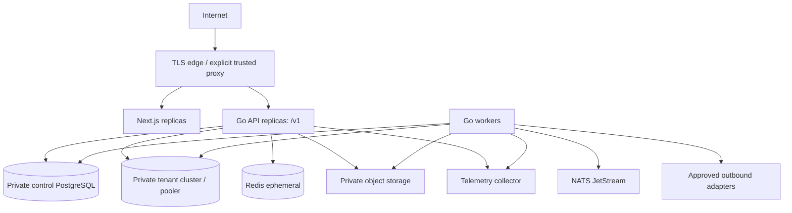

# Deployment architecture

Sources: [operations](../product/18_DEVOPS_DEPLOYMENT_OPERATIONS.md), [HLD §11](../product/08_HLD.md); OPS-001–006. Decisions [004, 013, 016](27_ARCHITECTURE_DECISIONS.md). Execution: [deployment plan](../implementation/17_DEVOPS_DEPLOYMENT.md).

## Topology and environments

Local Compose: API/web, PostgreSQL control and tenant databases, NATS, Redis, MinIO, Mailpit and scanner as slices need them. One local PostgreSQL server may host isolated databases; that is not permission to share tenant tables. Observability and later AI are optional profiles. No Compose files are created by this task.

Staging: production-like credentials, TLS, storage/versioning, migration behavior and network restrictions; synthetic/sanitized data only. Production: cloud/provider/region/HA and secret manager pending ADR-013; recommend simplest managed containers or reviewed VMs. Do not infer Kubernetes or a particular cloud.

## Network and identity

Only edge/web/API are browser reachable. Databases, broker, Redis, scanner, AI and administration endpoints remain private. Use service identities and scoped secrets; separate provisioner/migrator from API. TLS validates upstream identity. Public health exposes no cluster names or secret references. Readiness reflects required dependencies, liveness process responsiveness; optional AI failure must not remove deterministic bid service.

## Promotion and rollback

Promote immutable tested image digests, not rebuilds tagged latest. Compatible migrations run through a controlled job before exposure; canary tenant batches record status. Feature flags decouple deployment from capability activation. Roll back binaries only within schema compatibility; otherwise forward-fix or restore-to-new under incident control. Critical submission windows in future require release freeze policy.

## Acceptance

Staging evidence includes image provenance, network deny tests, secret rotation, graceful shutdown, migration rehearsal, smoke/E2E, backup/object restore and alert delivery to an owner. A container restart policy is not HA or disaster recovery. Production rollout remains blocked until provider, recovery targets and operating ownership are approved.
