# DevOps and CI/CD design

Sources: [operations §§5–6](../product/18_DEVOPS_DEPLOYMENT_OPERATIONS.md), [QA](../product/15_QA_TEST_STRATEGY.md). Decisions [008, 013](27_ARCHITECTURE_DECISIONS.md). Execution: [deployment](../implementation/17_DEVOPS_DEPLOYMENT.md).

## Pipeline

```mermaid
flowchart LR
  P[Reviewed change] --> F[Format / types / architecture boundaries]
  F --> C[OpenAPI and event compatibility]
  C --> U[Unit / domain / component tests]
  U --> D[Migration and integration tests]
  D --> E[E2E and accessibility smoke]
  E --> S[Secrets / dependencies / licenses / image scans]
  S --> B[Build immutable artifact + SBOM]
  B --> T[Staging migration and deployment]
  T --> V[Recovery / security / performance / UAT evidence]
  V --> A[Authorized promotion and feature activation]
```

CI host is not selected. Scripts/Make targets must reproduce all required checks outside a provider UI. Pin Go/Fiber, Node/package manager, PostgreSQL and image digests after compatibility verification. Generated DTO/sqlc drift is a failure, not silently regenerated during deployment.

## Change gates

Pull request: format, Go vet/static analysis, TypeScript strict checking, selected frontend lint, unit/component tests, affected SQL/migration integration, OpenAPI/event lint and breaking-change check, secret/dependency/license scans. Python checks become required only when Python exists. Protected review ownership covers domain, migrations, security, contracts and UX.

Candidate: build web/API/worker, image scan and SBOM/provenance, ephemeral multi-tenant integration, Playwright critical paths, accessible forms/matrix, upgrade tests and artifact signing where selected. No production secrets in PR jobs; untrusted contributions cannot access deployment credentials.

Release: staging evidence, approved policies/risks, restore rehearsal, SLO/load target, feature flag plan, on-call/runbook, release requirement mapping. Existing source prohibition on waiving cross-tenant/sealed confidentiality defects applies.

## Migration orchestration

Control migration → canary tenant migrations → compatible application deployment → smoke → bounded fleet rollout → feature activation. Exchange migration joins only when its release exists. Record checksums, source/target versions and failure thresholds. Rollback is compatibility-aware; never automatically execute destructive down migrations.

## Failure behavior

Failing gates block merge/promotion; retries do not erase flaky test evidence. Dependency outage can delay a pipeline but cannot become a passed security scan. Record skipped checks and owner-approved alternative evidence. Failed canary pauses fleet rollout. Production artifacts are identical to accepted staging digests.

## Evidence

Retain commit, tool versions, test reports, scan results, SBOM, image digests, migration ledger, approval and deployment/rollback history with approved retention. No claimed coverage percentage without measured report and scope.
