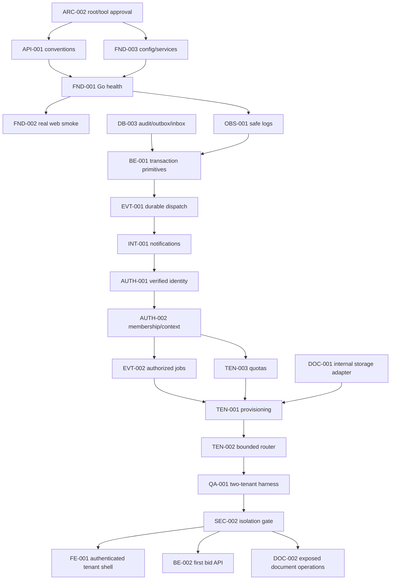
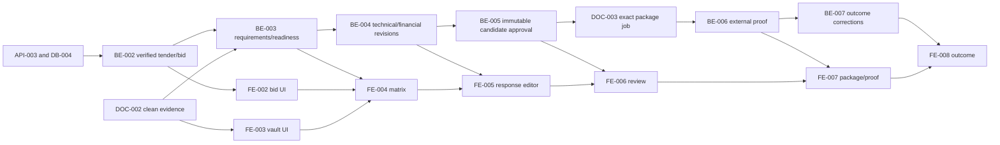
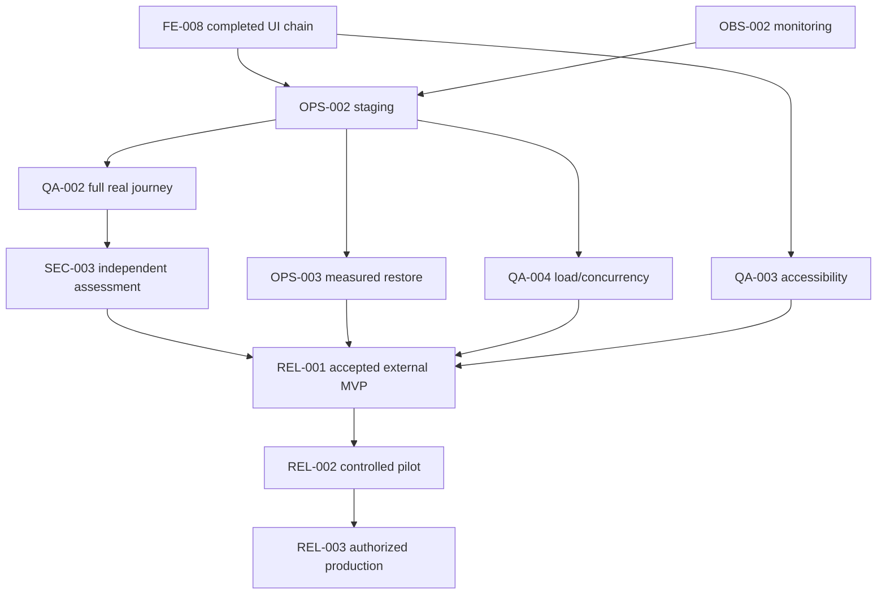
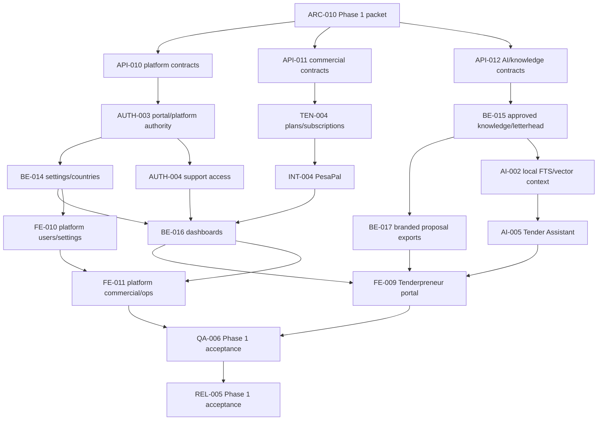

# Dependency graph and critical chains

## Authority

The complete adjacency list is the Dependencies column of [all 110 master rows](02_MASTER_BACKLOG.md), mirrored in each ticket. A dependency points from prerequisite to dependent. All referenced IDs exist; current graph is acyclic. Approval blockers and explicit implementation authorization are additional gates, not implicit Done nodes.

The diagrams below are deliberately selected critical chains, not a replacement for the complete adjacency list. Independent approved work may proceed in parallel; no calendar estimates are implied.

## Approved local-only child

[BID-FND-004](foundation/BID-FND-004.md) is the explicitly authorized local subset described in [packet 13](13_BACKEND_FOUNDATION_UNBLOCKING.md). Following the user's explicit split/start request, Docker-free [BID-FND-005](foundation/BID-FND-005.md) precedes FND-004; it was subsequently implemented manually and is now In Review, not accepted Done. FND-004 retains reviewed local pins/configuration/roles and Docker availability as explicit blockers. The full expanded graph now has 298 dependency edges, including the FND-005 → FND-004 edge, the Phase 1 portal children, ARC-010 → ARC-011 and the Platform Administrator lifecycle/remediation prerequisites. This child does not satisfy or remove the broader ARC-002/007/FND-003 gates and is not a substitute for their Done status.

## Foundation and protected tenancy

All abbreviated labels mean BID-* IDs. The full table additionally captures contract, schema, threat-model and root dependencies. There is no cycle through initial storage: DOC-001 is an **internal adapter**, not a public document handler. Provisioning is control-authorized before a tenant exists; TEN-002 handles business tenant routing afterward. EVT-001 is internal delivery infrastructure; EVT-002 adds current-actor authorization. Initial identity notices therefore do not require a provisioned business database.

SEC-002 tests existing router/storage/application boundaries, then every exposed endpoint extends it. It does not depend on the bid/document endpoints it gates. QA-001 is shared fixture infrastructure; earlier tickets still own their own unit/integration tests.

## External bid business path

API-005 precedes DB-006/response/review; API-006 precedes DB-007/package/proof/outcome. Their omission from this display does not relax those hard dependencies. All frontend operations consume the accepted generated client, not fabricated DTOs or mocked completion.

## Release path

Staging deployment is not release acceptance. M4 contains staging/verification/restore as prerequisites to scoped MVP acceptance; M5 is controlled pilot, M6 production authorization. Thus no later milestone must complete before an earlier one.

## Future design branch

ARC-010 → API-009/DB-008 and BE-008 requisition → BE-009 publication → BE-012 sealed acceptance → BE-013 opening → BE-010 evaluation → BE-011 award → QA-005 → REL-004. ARC-009 temporal/crypto review also gates API-009/DB-008/sealing. All BE-008–013 are **design** packets. QA-005/REL-004 retain explicit missing-runtime-child blockers; those children must become graph nodes before Ready.

ARC-010/ARC-008 → AI-001 contracts/privacy/corpus; DOC-002/EVT-002 plus BE-015 approved organization knowledge → AI-002 tenant-local FTS/vector retrieval; AI-001/DOC-002/EVT-002 → AI-003 parsing; AI-002/003 + BE-003 → AI-004 human-reviewed suggestions; API-012/BE-015/AI-004 → AI-005 Tender Assistant. REL-005 now owns the selected Phase 1 release gate; REL-004 retains future procurement/remaining capability-specific acceptance.

## Phase 1 Tenderpreneur and Platform Admin branch

SEC-004 retention/legal-hold execution additionally depends on API-010, AUTH-003 and measured restore work; it gates FE-011. These children make selected scope traceable, but all remain Blocked until their decisions, contracts and explicit implementation authorization are satisfied.

## Scheduling and validation

1. Resolve scoped decisions before implementation contracts; do not wait for all future ADRs.
2. Review contracts and persistence design together, then freeze bounded packet before handlers/UI.
3. Start each vertical slice only when its own gates hold. Prioritize user-operable increments over completing whole technical epics.
4. Compute topological order from metadata, not numeric ticket suffix. For example TEN-003 precedes TEN-001 despite numbering.
5. Validate no dependency milestone exceeds dependent milestone; all current metadata satisfies this. Milestones are latest evidence targets, not compulsory batch starts.
6. Revalidate after splits or new runtime children. Readiness also requires the [standards](06_TICKET_STANDARDS.md).

References: [implementation dependency matrix](../implementation/23_DEPENDENCY_MATRIX.md), [BID-ADR-018](../technical_design/27_ARCHITECTURE_DECISIONS.md), [module ownership](../technical_design/09_BACKEND_MODULE_DESIGN.md).
